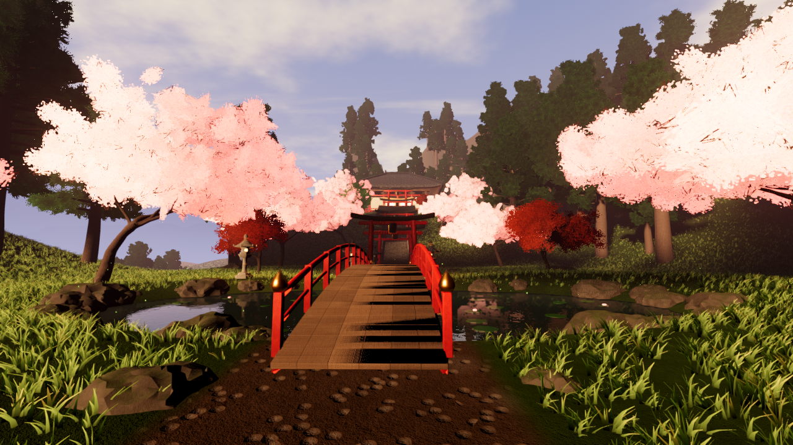

# Last Light Shrine

An explorable Godot 4.3 (Forward+) environment. It shows a hillside Shinto shrine in the last golden hour of a spring evening. Vermilion torii climb a mossy granite stair through cherry blossom to a cedar-and-tile main hall. A misty valley below holds a lone pagoda.

This is a graphics experiment. There's no gameplay, only walking.

The carnival horror prototype that used to live in this repository is preserved on the branch `backup/carnival-horror-prototype` (commit `8ee1928`).



More views are in `screenshots/`. All of them were captured from the running Godot 4.3 Forward+ renderer at 1280×720.

## Run

Open the folder in Godot 4.3 or later, then press F5. A dedicated GPU is recommended.

| Key | Action |
| --- | --- |
| WASD | Walk |
| Mouse | Look |
| Shift | Stroll faster |
| Space | Hop |
| Esc | Release the mouse |
| 1–7 | Jump to the curated viewpoints |
| P / F12 | Save a screenshot to `user://` |

## Art direction

The look is stylised realism, lit like a photograph rather than a game.

- **Light.** A low south-west sun rakes warm light across the stair, the torii and the hall façade. A cool sky fills the shadows. The look relies on readable long shadows, not darkness or heavy fog.
- **Palette.** Vermilion lacquer, sakura pink and moss green, set against blue-violet distance.
- **Composition.** A single processional axis runs from the arched bridge, past a stone lantern path and through a tunnel of *senbon* torii to the hall. A side overlook opens onto the valley and the pagoda.

## How it is made

All assets are generated by the scripts in `tools/`. No external or third-party assets are used, so there's nothing to attribute.

| File | What it produces |
| --- | --- |
| `tools/gen_textures.py` | Tileable PBR textures (albedo, normal, roughness) made with numpy FFT-filtered noise: granite, masonry, flagstone, aged wood, worn vermilion lacquer, kawara roof tiles, bark, grass, moss, dirt, gravel, cliff rock, plaster, shoji paper and water. It also paints alpha foliage atlases: sakura blossom, sugi needle sprays, maple leaves and petals. |
| `tools/build_world.py` | Blender 4 scripted modelling, exported as GLB. Uses bevels, displacement weathering, solidify roof shells with tile UVs that follow the slope, swept hip ridges, boolean-carved lanterns, skin-modifier trees with crown-shaped card normals and baked canopy AO, the terrain, the horizon and the mountain ranges. Godot collision comes from the `-col` / `-colonly` naming convention. |
| `tools/layout.py` | One shared heightfield and placement file, read by both Blender and Godot, so the terrain, stair, trees and props always agree. |

In Godot, custom shaders cover foliage (alpha-to-coverage, translucency, wind), grass, the terrain splat, triplanar mossy stone, per-instance lacquer, the mirror pond, raked gravel, the sky, the distant forest and aerial-perspective mountains.

The renderer uses SDFGI, volumetric fog, SSR, SSAO, PCSS sun shadows, ACES tonemapping and GPU particles (falling petals, sunlit pollen, fireflies).

## Rebuilding assets

These commands need Blender 4.x with numpy available.

```bash
python3 tools/gen_textures.py
```

```bash
python3 tools/layout.py
```

```bash
blender -b --python tools/build_world.py
```

```bash
python3 tools/fix_imports.py
```

`tools/capture.tscn` renders the curated viewpoints to PNG. It was used to check every change through the real Forward+ renderer.
